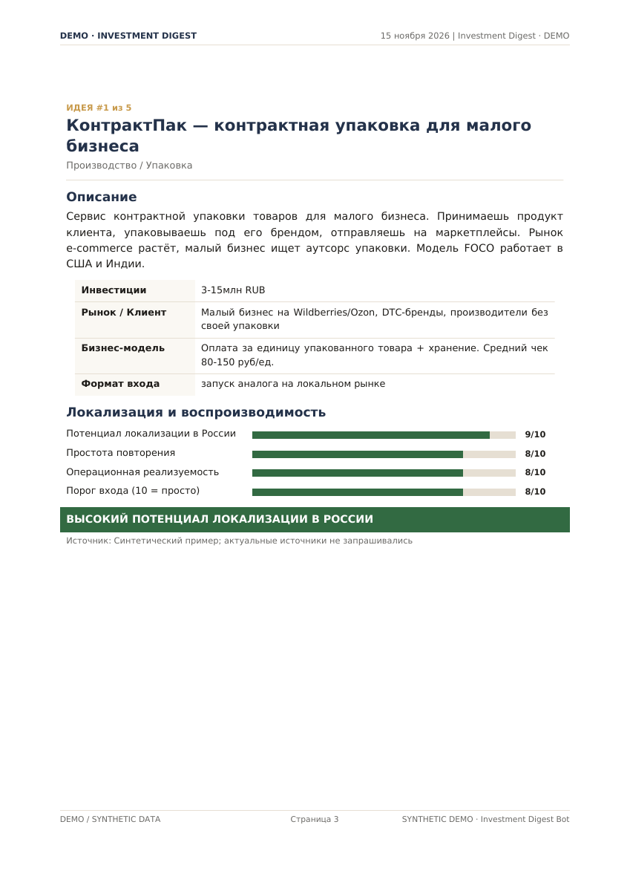
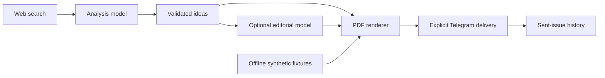

# Investment Digest Bot

[По-русски](README.ru.md)

A small Python prototype for turning web research into a readable PDF digest and, on an explicit live run, delivering it to Telegram. The report and local control panel are in Russian.

The experiment brings together a search provider, an analysis model, an optional editorial model and a repeatable document layout. Its value is the integration: a single path from a topic to a document, with local settings and a record of successfully sent issues. It does not establish the accuracy or profitability of model-generated investment ideas.



[Open the seven-page synthetic example](docs/demo-digest.pdf). All figures are demonstration data.

## Try the offline demo

Python **3.12** is the tested environment. No account, API key, model download or Telegram chat is required for the demo.

```sh
python3 -m venv .venv
. .venv/bin/activate
python -m pip install --only-binary=:all: --require-hashes -r requirements.lock
python run_bot.py --demo
```

On Windows, activate with `.venv\Scripts\activate` and use `python` for the same commands. The generated PDF is under `reports/`.

`--demo` uses explicitly synthetic examples, bypasses saved settings and history, and never calls search, LLMs or Telegram. Every PDF page is labelled **DEMO / SYNTHETIC DATA**. This mode can be run with networking disabled. The CLI rejects `--test-tg` together with either `--demo` or `--pdf-only`, before sending a connectivity message.

## What is implemented

- Web-context collection through DuckDuckGo, or provider-specific Perplexity/OpenAI paths.
- Configurable analysis through Ollama or an OpenAI-compatible API, with an optional separate writer.
- Structured idea validation before rendering and literal handling of external text in PDFs.
- PDF covers, executive summaries, idea cards and several visual themes.
- Explicit Telegram delivery and local sent-issue/topic records.
- A loopback-only Flask control panel for settings and one-shot operations.



## Live configuration

Copy `.env.example` to `.env` only when you want to configure external services. Keep it local. The panel displays whether a key is set, not its value.

```sh
python admin_panel.py
```

Open `http://127.0.0.1:8787`. Set the search provider, model endpoint and Telegram destination there. An Ollama endpoint can still use a cloud-backed model; check the selected model's own requirements and charges. Live preview and PDF-only runs can call external providers.

| Command | Behaviour |
|---|---|
| `python run_bot.py --demo` | Offline synthetic PDF; no delivery or sent-history update. |
| `python run_bot.py --pdf-only` | Live search/model calls and PDF; no Telegram delivery. |
| `python run_bot.py` | Live pipeline and Telegram delivery when configured. |
| `python run_bot.py --test-tg` | Explicit Telegram connectivity message. |

A failed live search raises an error. It never silently substitutes demonstration ideas. An unsuccessful delivery is not recorded as a successful issue. Local state updates are not a transactional exactly-once delivery system; a crash or retry can still produce duplicates.

The local scheduler is enabled explicitly from the protected panel. It is not a hosted scheduler and is not activated by opening a page. It runs only while the local panel process is alive and must be enabled again after a restart. The old Windows Task Scheduler helper was removed during security cleanup; no operating-system scheduled task is installed by this project.

## Validation and limits

Run the offline regression suite:

```sh
python -m unittest discover -s tests -v
```

See [validation evidence](docs/VALIDATION.md) for exactly what was tested, and [security boundaries](SECURITY.md) for the local-panel and credential model. Provider integrations and delivery to a real Telegram account were not exercised during portfolio preparation. A source URL in model output is not independently verified evidence, and topic memory is heuristic name matching rather than semantic retrieval.

## Repository map

- `run_bot.py`, `bot_services.py` — CLI and pipeline orchestration.
- `generic_searcher.py`, `searcher*.py`, `llm_client.py` — retrieval and model adapters.
- `editorial_ai.py`, `idea_validation.py`, `pdf_generator.py` — structured content and document creation.
- `admin_panel.py`, `runtime_settings.py`, `secrets_manager.py` — local management.
- `state_manager.py`, `scheduler_runtime.py`, `telegram_sender.py` — state, scheduling and delivery.
- `tests/`, `fonts/`, `docs/` — regressions, licensed font inputs and a synthetic example.

Own code is [MIT](LICENSE). DejaVu fonts and dependencies have separate terms in [THIRD_PARTY.md](THIRD_PARTY.md). Runtime state, reports, logs and credentials are excluded from Git.
