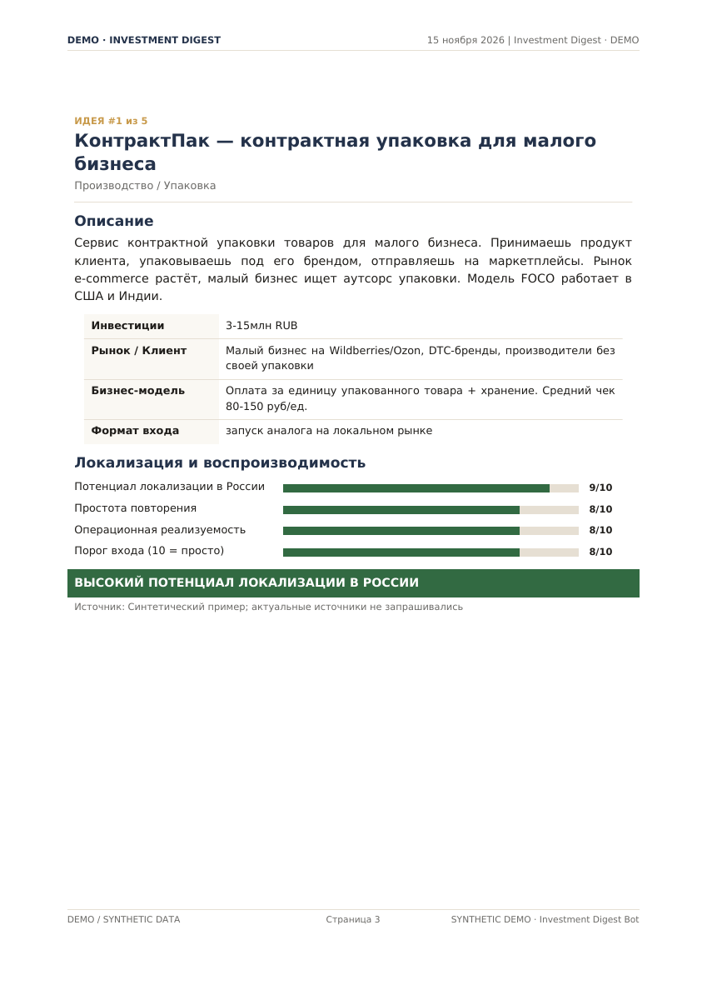

# Бот для инвестиционных дайджестов

[English](README.md)

Бот ищет материалы об инвестиционных идеях и собирает выпуск в PDF. Для знакомства уже есть [пример на семь страниц](docs/demo-digest.pdf). Цифры и идеи в примере вымышлены.



### Почему подготовка PDF отделена от отправки

Я разделил подготовку PDF и отправку в Telegram. В режиме «только PDF» можно прочитать готовый выпуск. Бот добавляет его в историю отправленных только после успешного ответа Telegram. Демо работает на вымышленных данных, поэтому для знакомства не нужны ключи и платные запросы.

## Как попробовать демо

Для демо подходит Python 3.12. Создайте виртуальное окружение в каталоге проекта и установите зависимости из файла с контрольными суммами.

```sh
python3 -m venv .venv
. .venv/bin/activate
python -m pip install --only-binary=:all: --require-hashes -r requirements.lock
python run_bot.py --demo
```

В Windows окружение активируется командой `.venv\Scripts\activate`. Готовый файл появится в `reports/`. После установки зависимостей демо работает без сети, ключей, модели и доступа к Telegram.

## Что происходит в рабочем режиме

| Команда | Результат |
|---|---|
| `python run_bot.py --demo` | Автономный выпуск на вымышленных данных. |
| `python run_bot.py --pdf-only` | Поиск и подготовка PDF с настроенными провайдерами. Доставка в Telegram отключена. |
| `python run_bot.py` | Рабочий выпуск и отправка в настроенный чат Telegram. |
| `python run_bot.py --test-tg` | Отдельное тестовое сообщение в Telegram. |

Проверка Telegram несовместима с режимами `--demo` и `--pdf-only`. Ключи, настройки чатов, журналы и реальные выпуски храните локально. Панель управления рассчитана на одного пользователя и слушает `127.0.0.1`. Перед использованием материалов проверяйте факты и ссылки на источники.

[Устройство проекта и настройка провайдеров](README.md#live-configuration) · [Безопасность и хранение данных](SECURITY.md) · [Проверки и ограничения](docs/VALIDATION.md) · [Лицензия](LICENSE)
